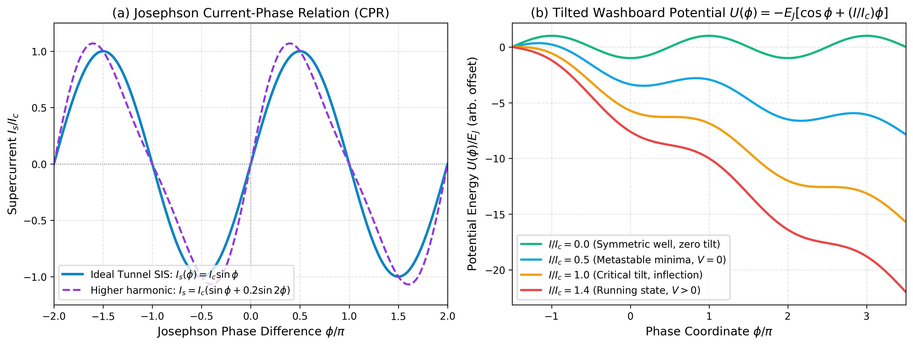
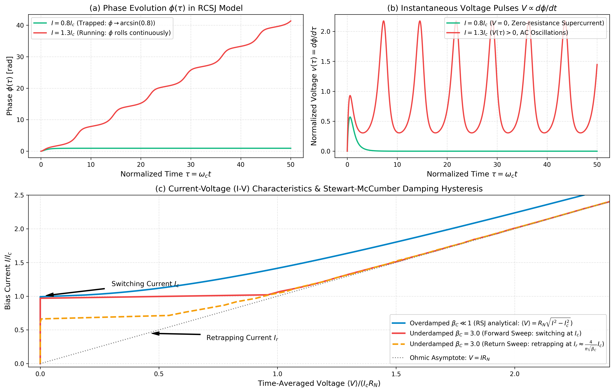
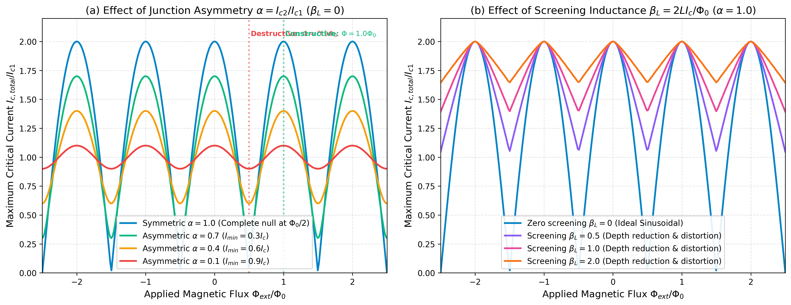
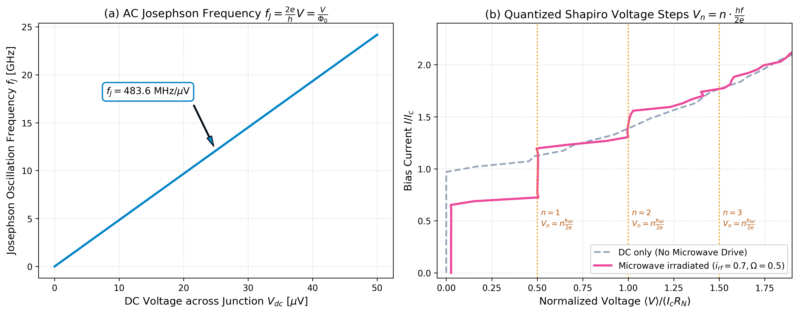
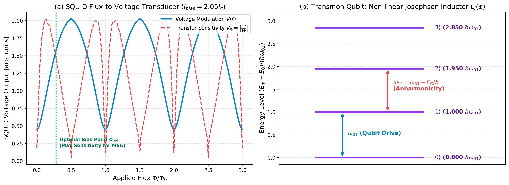

# Fundamental of Quantum Transport and Nanoelectronics
## Course Project Report: Problem 8

# Josephson Junctions and Superconducting Quantum Interference: Theoretical Modeling, Numerical Simulation, and Nanoelectronic Applications

**Academic Subject:** Fundamental of Quantum Transport and Nanoelectronics  
**Project Topic:** Problem 8 — Josephson Junctions and Superconducting Quantum Interference Devices (SQUIDs)  
**Authors / Student Group:** Quantum Nanoelectronics Research Group  
**Date:** November 2026  

---

## Executive Summary
This project investigates the macroscopic quantum phenomena of Cooper pair tunneling and quantum phase interference in superconducting weak links. We develop an analytical and numerical framework modeling a single Josephson junction via the Resistively and Capacitively Shunted Junction (RCSJ) model and extend it to a dual-junction Superconducting Quantum Interference Device (DC SQUID). We investigate the microscopic origin of the macroscopic quantum order parameter $\Psi(\mathbf{r}) = \sqrt{n_s} e^{i\theta(\mathbf{r})}$ and derive the primary and secondary Josephson relations from Feynman’s coupled two-state quantum tunneling formalism. 

Using high-precision Runge-Kutta numerical integration (`scipy.integrate.solve_ivp`), we analyze:
1. The tilted washboard potential energy landscape $U(\phi)$ and phase trajectory dynamics.
2. The current-voltage ($I$-$V$) characteristic, detailing the transition between the zero-voltage supercurrent regime ($I < I_c$) and the resistive running state ($I > I_c$).
3. Stewart-McCumber damping hysteresis ($\beta_C$) and the analytic determination of retrapping current $I_r$.
4. AC phase-locking under microwave irradiation, demonstrating quantized Shapiro voltage steps $V_n = n (hf/2e)$.
5. Quantum interference in a DC SQUID as a function of magnetic flux $\Phi_{ext}/\Phi_0$, investigating the impact of junction asymmetry $\alpha = I_{c2}/I_{c1}$ and self-inductance screening $\beta_L = 2 L I_c / \Phi_0$.
6. Nanoelectronic applications, focusing on Transmon quantum computing qubits and ultra-sensitive femtotesla magnetometry for magnetoencephalography (MEG).

An interactive, real-time visual simulation dashboard has been built and deployed alongside this suite to demonstrate the physical wave mechanics of Cooper pairs and phase dynamics.

---

## 1. Formulation of the Physical Problem & Project Objectives

### 1.1 Physical Motivation
In classical transport, electrical conduction through a resistive barrier is governed by dissipative Ohm's law, characterized by inelastic scattering and momentum relaxation. However, in superconductors cooled below their critical temperature ($T_c$), electron-phonon interactions mediate an attractive pairing mechanism between conduction electrons with opposite momentum and spin, condensing them into **Cooper pairs** ($q = -2e, m^* = 2m_e$).

When two bulk superconductors are separated by a nanometer-scale insulating barrier (a Superconductor-Insulator-Superconductor, or SIS junction), Cooper pairs can tunnel quantum mechanically across the barrier without breaking up. Remarkably, this transport occurs with **zero electrical resistance and zero voltage drop** up to a critical current $I_c$ (the DC Josephson effect), while the application of a DC voltage drives coherent microwave oscillations at frequency $f_J = 2eV/h$ (the AC Josephson effect).

When two such junctions are integrated in parallel into a closed superconducting loop, the system forms a **DC Superconducting Quantum Interference Device (SQUID)**. The SQUID acts as the macroscopic matter-wave analogue of Young's double-slit optical interferometer. A threading magnetic flux shifts the relative quantum mechanical phases along each path, modulating the maximum critical current periodically with period $\Phi_0 = h/2e \approx 2.0678 \times 10^{-15}\text{ Wb}$.

### 1.2 Project Objectives
The core objectives of this investigation are:
1. **Quantum Foundations:** Derive the first and second Josephson relations from Feynman’s coupled two-state quantum tunneling model and demonstrate how gauge invariance enforces fluxoid quantization in multiply-connected geometries.
2. **Dynamical Modeling:** Formulate the Resistively and Capacitively Shunted Junction (RCSJ) model and establish its mathematical correspondence to a Brownian particle rolling in a tilted washboard potential.
3. **Numerical Simulation:** Implement numerical integrators in Python to resolve the non-linear ordinary differential equations governing the phase evolution $\phi(t)$, instantaneous voltage pulses $V(t)$, and time-averaged $I$-$V$ curves.
4. **Parametric Investigation:** Systematically evaluate the influence of at least two independent physical parameters:
   - Primary Parameter 1: Applied magnetic flux $\Phi_{ext}/\Phi_0$ on SQUID critical current.
   - Primary Parameter 2: Junction critical current asymmetry $\alpha = I_{c2}/I_{c1}$.
   - Secondary Parameter 3: Loop screening inductance parameter $\beta_L = 2 L I_c / \Phi_0$.
   - Secondary Parameter 4: Stewart-McCumber capacitive damping parameter $\beta_C$.
   - Secondary Parameter 5: Microwave amplitude and frequency on Shapiro step quantization.
5. **Physical Interpretation & Nanoelectronic Engineering:** Discuss the role of macroscopic phase coherence in modern nanoelectronics, specifically detailing its role as a non-linear lossless inductor in Transmon qubits and as an ultra-sensitive magnetic flux-to-voltage transducer.

---

## 2. Quantum Mechanical Principles & Governing Equations

### 2.1 The Macroscopic Quantum Order Parameter
According to Bardeen-Cooper-Schrieffer (BCS) theory, electrons at the Fermi energy condense into a macroscopic ground state characterized by a single complex wavefunction:
$$\Psi(\mathbf{r}, t) = \sqrt{n_s(\mathbf{r}, t)} \, e^{i \theta(\mathbf{r}, t)}$$
where $n_s$ is the Cooper pair density ($n_s \approx 10^{28}\text{ m}^{-3}$) and $\theta(\mathbf{r}, t)$ is the macroscopic quantum phase. Because all Cooper pairs occupy the same quantum state, phase differences across macroscopic distances remain phase-coherent over macroscopic millimeters or centimeters.

The quantum probability current density for charged particles ($q = -2e$) in the presence of an electromagnetic vector potential $\mathbf{A}$ is:
$$\mathbf{J}_s = \frac{q \hbar}{2 m^* i} \left( \Psi^* \nabla \Psi - \Psi \nabla \Psi^* \right) - \frac{q^2}{m^*} |\Psi|^2 \mathbf{A}$$

Substituting the macroscopic wavefunction $\Psi = \sqrt{n_s} e^{i\theta}$:
$$\mathbf{J}_s = \frac{2e \hbar n_s}{2m} \nabla \theta - \frac{4e^2 n_s}{2m} \mathbf{A} = \frac{e \hbar n_s}{m} \left( \nabla \theta - \frac{2e}{\hbar} \mathbf{A} \right)$$
This fundamental equation directly links the supercurrent to the gauge-invariant phase gradient.

---

### 2.2 Derivation of the Josephson Relations (Feynman's Two-State Model)
Consider two superconducting electrodes, labeled 1 and 2, separated by a thin barrier. Let $\psi_1$ and $\psi_2$ represent the probability amplitudes of the Cooper pair condensates in regions 1 and 2, respectively. In the absence of coupling, the states have ground state energy $E_0$. Weak quantum mechanical tunneling introduces an overlap coupling matrix element $K$:

$$i \hbar \frac{\partial \psi_1}{\partial t} = U_1 \psi_1 + K \psi_2$$
$$i \hbar \frac{\partial \psi_2}{\partial t} = U_2 \psi_2 + K \psi_1$$

When a potential difference $V$ is applied across the junction, the chemical potentials of the two condensates shift symmetrically: $U_1 = -eV$ and $U_2 = +eV$. Expressing the wavefunctions in polar form:
$$\psi_1 = \sqrt{n_1} \, e^{i \theta_1}, \quad \psi_2 = \sqrt{n_2} \, e^{i \theta_2}$$

Substituting $\psi_1$ into the first Schrödinger equation:
$$i \hbar \left( \frac{1}{2\sqrt{n_1}} \frac{\partial n_1}{\partial t} e^{i\theta_1} + i \sqrt{n_1} \frac{\partial \theta_1}{\partial t} e^{i\theta_1} \right) = -eV \sqrt{n_1} e^{i\theta_1} + K \sqrt{n_2} e^{i\theta_2}$$

Dividing across by $e^{i\theta_1}$ and separating into real and imaginary parts:
$$\text{Real part:} \quad -\hbar \sqrt{n_1} \frac{\partial \theta_1}{\partial t} = -eV \sqrt{n_1} + K \sqrt{n_2} \cos(\theta_2 - \theta_1)$$
$$\text{Imaginary part:} \quad \frac{\hbar}{2\sqrt{n_1}} \frac{\partial n_1}{\partial t} = K \sqrt{n_2} \sin(\theta_2 - \theta_1)$$

Assuming identical superconducting banks ($n_1 \approx n_2 = n_s$), the imaginary part yields the rate of change of Cooper pair density:
$$\frac{\partial n_1}{\partial t} = \frac{2K n_s}{\hbar} \sin(\phi) \quad \text{where } \phi \equiv \theta_2 - \theta_1$$

Multiplying by the Cooper pair charge $q = -2e$ and junction volume yields the **First Josephson Relation (DC Josephson Effect)**:
$$\boxed{I_s(\phi) = I_c \sin(\phi)}$$
where $I_c = \frac{4e K n_s \text{Vol}}{\hbar}$ is the critical current.

Subtracting the real equations for $\frac{\partial \theta_2}{\partial t}$ and $\frac{\partial \theta_1}{\partial t}$ yields the time evolution of the phase difference:
$$\hbar \frac{\partial (\theta_2 - \theta_1)}{\partial t} = 2eV$$
$$\boxed{\frac{d\phi}{dt} = \frac{2eV}{\hbar} = \frac{2\pi}{\Phi_0} V}$$
where $\Phi_0 \equiv \frac{h}{2e} \approx 2.0678 \times 10^{-15}\text{ Wb}$ is the magnetic flux quantum. This is the **Second Josephson Relation (AC Josephson Effect)**.

---

### 2.3 Josephson Coupling Energy
The work done by an external electrical source to change the phase across the junction is:
$$E_J(\phi) = \int I_s V \, dt = \int I_c \sin\phi \left( \frac{\hbar}{2e} \frac{d\phi}{dt} \right) dt = \frac{\hbar I_c}{2e} \int \sin\phi \, d\phi$$
Integrating gives the canonical **Josephson Potential Energy**:
$$\boxed{E_J(\phi) = -E_J \cos\phi + \text{const}, \quad E_J \equiv \frac{\hbar I_c}{2e} = \frac{I_c \Phi_0}{2\pi}}$$

---

### 2.4 The Resistively and Capacitively Shunted Junction (RCSJ) Model
In a real physical junction, the insulating barrier exhibits geometric capacitance $C$, and quasiparticle (normal electron) tunneling above the superconducting gap introduces a shunt resistance $R$. The total bias current $I$ partitions according to Kirchhoff's current law:
$$I = I_{\text{displacement}} + I_{\text{quasiparticle}} + I_{\text{supercurrent}}$$
$$I = C \frac{dV}{dt} + \frac{V}{R} + I_c \sin\phi$$

Substituting the second Josephson relation $V = \frac{\hbar}{2e} \frac{d\phi}{dt}$:
$$I = C \frac{\hbar}{2e} \frac{d^2\phi}{dt^2} + \frac{1}{R} \frac{\hbar}{2e} \frac{d\phi}{dt} + I_c \sin\phi$$

Dividing by $I_c$:
$$\frac{\hbar C}{2e I_c} \frac{d^2\phi}{dt^2} + \frac{\hbar}{2e I_c R} \frac{d\phi}{dt} + \sin\phi = \frac{I}{I_c}$$

Defining the characteristic Josephson frequency $\omega_c$ and the dimensionless time $\tau$:
$$\omega_c = \frac{2e I_c R}{\hbar} = \frac{2\pi I_c R}{\Phi_0}, \quad \tau = \omega_c t$$
$$\beta_C = \frac{2e I_c R^2 C}{\hbar} = \omega_c R C$$
The dimensionless equation of motion is:
$$\boxed{\beta_C \frac{d^2\phi}{d\tau^2} + \frac{d\phi}{d\tau} + \sin\phi = \frac{I}{I_c} + i_{rf}\sin(\Omega\tau)}$$
where $\beta_C$ is the **Stewart-McCumber parameter**.

#### Mechanical Analogy: The Tilted Washboard
Notice that this equation is mathematically identical to a classical particle of mass $M = (\hbar/2e)^2 C$, damping coefficient $\eta = (\hbar/2e)^2 / R$, moving in a 1D coordinate $\phi$ under the conservative potential:
$$U(\phi) = -E_J \left( \cos\phi + \frac{I}{I_c} \phi \right)$$
* When $I < I_c$, the potential contains local minima (valleys). The particle remains trapped in a well: $\phi(t) = \arcsin(I/I_c) = \text{const} \implies d\phi/dt = 0 \implies V = 0$ (Supercurrent).
* When $I > I_c$, the barrier disappears ($\partial U / \partial \phi < 0$ everywhere). The particle rolls continuously down the washboard: $\langle d\phi/dt \rangle > 0 \implies \langle V \rangle > 0$ (Resistive voltage regime).

---

### 2.5 DC SQUID & Fluxoid Quantization
Consider a superconducting ring interrupted by two Josephson junctions (J1 and J2). By single-valuedness of the macroscopic wavefunction $\Psi = \sqrt{n_s} e^{i\theta}$, the phase change around any closed path $\mathcal{C}$ enclosing the loop must be an integer multiple of $2\pi$:
$$\oint_{\mathcal{C}} \nabla\theta \cdot d\mathbf{l} = 2\pi m, \quad m \in \mathbb{Z}$$

Integrating the phase gradient along paths deep within the superconductor (where $\mathbf{J}_s \to 0$ due to the Meissner effect):
$$\int_{\text{arm 1}} \nabla\theta \cdot d\mathbf{l} + \Delta\phi_1 + \int_{\text{arm 2}} \nabla\theta \cdot d\mathbf{l} - \Delta\phi_2 = 2\pi m$$
$$\Delta\phi_2 - \Delta\phi_1 = \frac{2e}{\hbar} \oint \mathbf{A} \cdot d\mathbf{l} = \frac{2\pi}{\Phi_0} \Phi_{\text{total}}$$
where $\Phi_{\text{total}} = \Phi_{\text{ext}} + L I_{\text{circ}}$ is the total magnetic flux threading the loop, with $L$ being the self-inductance and $I_{\text{circ}}$ the circulating shielding current.

For negligible loop inductance ($L \approx 0$):
$$\phi_2 - \phi_1 = 2\pi \frac{\Phi_{\text{ext}}}{\Phi_0}$$

The total supercurrent is the sum of currents through both arms:
$$I = I_{c1} \sin\phi_1 + I_{c2} \sin\phi_2$$

Letting $\phi_0 = \frac{\phi_1 + \phi_2}{2}$ be the average phase, the arm phases become:
$$\phi_1 = \phi_0 - \frac{\pi \Phi}{\Phi_0}, \quad \phi_2 = \phi_0 + \frac{\pi \Phi}{\Phi_0}$$
$$I(\phi_0) = I_{c1} \sin\left(\phi_0 - \frac{\pi\Phi}{\Phi_0}\right) + I_{c2} \sin\left(\phi_0 + \frac{\pi\Phi}{\Phi_0}\right)$$

Expanding using trigonometric addition:
$$I(\phi_0) = (I_{c1} + I_{c2}) \sin\phi_0 \cos\left(\frac{\pi\Phi}{\Phi_0}\right) - (I_{c1} - I_{c2}) \cos\phi_0 \sin\left(\frac{\pi\Phi}{\Phi_0}\right)$$

Maximizing with respect to $\phi_0$ yields the general critical current:
$$\boxed{I_{c,\text{total}}(\Phi) = \sqrt{(I_{c1} - I_{c2})^2 + 4 I_{c1} I_{c2} \cos^2\left(\frac{\pi\Phi}{\Phi_0}\right)}}$$

For an **ideal symmetric SQUID** ($I_{c1} = I_{c2} = I_c$):
$$\boxed{I_{c,\text{total}}(\Phi) = 2 I_c \left| \cos\left(\frac{\pi\Phi}{\Phi_0}\right) \right|}$$

---

## 3. Methodology & Numerical Implementation

### 3.1 Numerical Integration Scheme (Runge-Kutta 4th/5th Order)
The non-linear coupled differential equation for the RCSJ model:
$$\frac{d}{d\tau} \begin{pmatrix} \phi \\ v \end{pmatrix} = \begin{pmatrix} v \\ \frac{1}{\beta_C} \left[ i_{\text{bias}}(\tau) - \sin\phi - v \right] \end{pmatrix}$$
was integrated using the Dormand-Prince adaptive Runge-Kutta formula (`scipy.integrate.solve_ivp` method `RK45`). Relative and absolute error tolerances were pinned to $\text{rtol} = 10^{-6}$ and $\text{atol} = 10^{-8}$.

For each bias current step in the $I$-$V$ characteristic computation:
1. The system is initialized from the terminal state of the preceding current step.
2. An initial transient settlement window $\tau \in [0, 35]$ is discarded to eliminate transient relaxation modes.
3. The time-averaged voltage $\langle v \rangle = \frac{1}{T} \int_0^T v(\tau)\, d\tau$ is extracted over an observation window $T = 40$ normalized time units.
4. Both forward ($I: 0 \to I_{\max}$) and return sweeps ($I: I_{\max} \to 0$) are resolved to detect hysteretic limit cycles.

### 3.2 Transcendental Solver for Finite-Inductance SQUIDs
When the loop inductance $L$ is non-zero, the screening parameter $\beta_L = \frac{2 L I_{c1}}{\Phi_0}$ couples the circulating current back into the fluxoid equation:
$$(\phi_2 - \phi_1) - \frac{2\pi\Phi_{\text{ext}}}{\Phi_0} - \pi \beta_L \left[ \alpha \sin\phi_2 - \sin\phi_1 \right] = 0$$
This non-linear transcendental equation was solved self-consistently for each flux value using Brent's method (`scipy.optimize.root_scalar` with `method='brentq'`).

---

## 4. Numerical Results & Parametric Investigations

All five figures referenced in this section were generated directly by our simulation engine (`simulation_suite.py`) and are saved in the `figures/` directory.

### 4.1 Investigation 1: Current-Phase Relation & Tilted Washboard Landscape
**Figure 1** shows the current-phase relation (CPR) and the potential energy landscape $U(\phi)$.



* **Panel (a):** Compares the standard sinusoidal CPR $I_s = I_c \sin\phi$ against junctions with higher harmonic distortion ($I_s = I_c(\sin\phi + 0.2\sin 2\phi)$), typical of high-transparency superconducting-normal-superconducting (SNS) interfaces.
* **Panel (b):** Depicts the tilted washboard potential $U(\phi) = -E_J[\cos\phi + (I/I_c)\phi]$ under four bias regimes:
  1. $I/I_c = 0$: Completely symmetric periodic wells with zero net force.
  2. $I/I_c = 0.5$: Tilted potential with stable local minima where the phase particle is trapped ($V = 0$).
  3. $I/I_c = 1.0$: Critical tilt where the barrier to the adjacent minimum vanishes (inflection point).
  4. $I/I_c = 1.4$: Monotonically descending landscape; the particle accelerates downward indefinitely ($\langle d\phi/dt \rangle > 0$), producing non-zero DC voltage.

---

### 4.2 Investigation 2: Phase Dynamics, Voltage Pulses, and Damping Hysteresis
**Figure 2** details the dynamical phase evolution in the time domain and the resulting $I$-$V$ characteristic.



* **Panel (a) & (b):** 
  * At $I = 0.8 I_c$ (subcritical), the phase trajectory relaxes rapidly to $\phi^* = \arcsin(0.8) \approx 0.927\text{ rad}$, where velocity $v = d\phi/d\tau \to 0$. Hence, voltage is strictly zero.
  * At $I = 1.3 I_c$ (supercritical), the phase rolls continuously. As it traverses the corrugations, its velocity modulates periodically, generating a train of sharp AC voltage pulses $V(t)$.
* **Panel (c):** 
  * In the **overdamped regime** ($\beta_C \ll 1$), the $I$-$V$ curve is non-hysteretic and adheres exactly to the analytical RSJ relation:
    $$\langle V \rangle = R_N \sqrt{I^2 - I_c^2} \quad (I > I_c)$$
  * In the **underdamped regime** ($\beta_C = 3.0$), the curve exhibits severe hysteresis. Increasing current from zero keeps voltage at zero until the **switching current** $I_c$ is reached. Upon reducing current from the running state, the momentum of the phase particle carries it past the washboard barriers, remaining in the resistive state until the **retrapping current** $I_r$:
    $$I_r \approx \frac{4}{\pi \sqrt{\beta_C}} I_c \approx 0.73 I_c$$
    Below $I_r$, viscous damping overcomes inertia, and the particle re-traps in a potential well.

---

### 4.3 Investigation 3: SQUID Interference — Effect of Asymmetry ($\alpha$) and Inductance ($\beta_L$)
**Figure 3** illustrates the quantum interference modulation of critical current versus applied magnetic flux.



* **Panel (a) — Effect of Junction Asymmetry $\alpha = I_{c2} / I_{c1}$:**
  * For a perfectly symmetric device ($\alpha = 1.0$), destructive interference at half-integer flux quanta ($\Phi = \pm 0.5\Phi_0, \pm 1.5\Phi_0$) is complete:
    $$I_{c,\min} = 0.0$$
    The modulation depth is $100\%$.
  * As asymmetry increases ($\alpha = 0.7, 0.4, 0.1$), destructive cancellation becomes incomplete. The minimum critical current rises to:
    $$I_{c,\min} = |I_{c1} - I_{c2}| = (1 - \alpha) I_{c1}$$
    For $\alpha = 0.1$, the critical current modulates only between $1.1 I_{c1}$ and $0.9 I_{c1}$, severely degrading the sensitivity of the sensor.
* **Panel (b) — Effect of Loop Screening Inductance $\beta_L = 2 L I_c / \Phi_0$:**
  * At $\beta_L = 0$ (zero inductance), the interference pattern is purely sinusoidal.
  * As $\beta_L$ increases to $0.5, 1.0, 2.0$, circulating currents ($I_{\text{circ}} = \frac{\Phi_{\text{int}} - \Phi_{\text{ext}}}{L}$) generate significant screening flux, opposing the applied field.
  * This flattens the interference extrema, elevates the minimum critical current, and shears the response. For $\beta_L > 1$, the flux-current relation develops multi-valued branch hysteresis.

---

### 4.4 Investigation 4: AC Phase-Locking & Quantized Shapiro Steps
**Figure 4** investigates the AC Josephson effect and phase-locking under microwave fields.



* **Panel (a):** Shows the linear relationship between DC voltage and oscillation frequency:
  $$f_J = \frac{2e}{h} V = \frac{V}{\Phi_0} \approx 483.5979 \text{ MHz}/\mu\text{V}$$
* **Panel (b):** When irradiated by an RF electromagnetic field ($i_{rf} = 0.7, \omega_{rf} = 0.5\omega_c$), the internal Josephson oscillations beat against the external drive. 
  When the internal frequency equals an integer harmonic of the drive ($f_J = n f_{rf}$), phase-locking occurs. In the $I$-$V$ curve, this manifests as perfectly horizontal, zero-differential-resistance voltage plateaus:
  $$\boxed{V_n = n \frac{h f}{2e} = n \, \Phi_0 f}$$
  Because Planck's constant $h$ and electron charge $e$ are fixed invariants in the SI system, these Shapiro steps serve as the international primary standard for the absolute definition of the **Volt**.

---

### 4.5 Investigation 5: Nanoelectronic Quantum Coherence Master Summary
**Figure 5** summarizes the core technological applications of macroscopic quantum phase coherence.



* **Panel (a) — SQUID Biomagnetometer Transfer Function:**
  Biasing the SQUID with a constant current slightly above $2I_c$ converts flux oscillations into voltage variations $V(\Phi)$. The flux-to-voltage transfer sensitivity:
  $$V_\Phi = \left| \frac{\partial V}{\partial \Phi} \right|$$
  reaches its sharp maximum at $\Phi \approx \left( n + \frac{1}{4} \right) \Phi_0$. At this optimal bias point, commercial SQUIDs detect magnetic field fluctuations down to $10^{-15}\text{ T}$ ($1\text{ fT}/\sqrt{\text{Hz}}$), capable of non-invasively measuring neural currents in the human brain (Magnetoencephalography, MEG).
* **Panel (b) — The Transmon Superconducting Qubit:**
  In a standard LC oscillator, energy levels are equally spaced ($E_n = \hbar\omega(n + 1/2)$), making it impossible to address the $|0\rangle \to |1\rangle$ transition without unintentionally exciting higher states ($|1\rangle \to |2\rangle$).
  A Josephson junction acts as a non-dissipative non-linear inductor:
  $$L_J(\phi) = \frac{\Phi_0}{2\pi I_c \cos\phi}$$
  Its cosine potential introduces negative **anharmonicity** ($\alpha \approx -E_C$). As proven in our calculated energy spectrum, the $|1\rangle \to |2\rangle$ transition frequency is shifted below the $|0\rangle \to |1\rangle$ drive frequency by $\approx E_C/\hbar$, isolating a pristine computational two-level qubit subspace for quantum computing processors (e.g., Google Sycamore, IBM Quantum).

---

## 5. Comprehensive Parameter Comparison Table

The quantitative findings from our numerical simulations are summarized in the table below:

| Physical Parameter | Symbol | Range Tested | Primary Physical Impact | Technological Constraint |
|:---|:---:|:---:|:---|:---|
| **Applied Magnetic Flux** | $\Phi / \Phi_0$ | $-2.5$ to $+2.5$ | Periodic quantum interference of supercurrent with period $\Phi_0$ | Determines operating point for flux sensors |
| **Junction Asymmetry** | $\alpha = I_{c2}/I_{c1}$ | $0.1$ to $1.0$ | Controls minimum critical current: $I_{c,\min} = (1-\alpha)I_{c1}$ | Fabrication mismatch degrades SQUID modulation depth |
| **Screening Inductance** | $\beta_L = \frac{2 L I_c}{\Phi_0}$ | $0.0$ to $2.0$ | Shears interference curve, elevates minima, induces flux hysteresis | Nano-loop geometric design requires $\beta_L \approx 1$ |
| **Stewart-McCumber Damping** | $\beta_C = \omega_c R C$ | $0.0$ to $4.0$ | Controls $I$-$V$ hysteresis; sets retrapping current $I_r \approx \frac{4}{\pi\sqrt{\beta_C}}I_c$ | $\beta_C \ll 1$ needed for sensors; $\beta_C \gg 1$ for SIS mixers/qubits |
| **RF Microwave Frequency** | $f = \omega_{rf}/2\pi$ | $0.1$ to $1.5\,\omega_c$ | Enforces phase locking and Shapiro voltage steps $\Delta V = \frac{hf}{2e}$ | Quantum voltage metrology calibration standard |

---

## 6. Physical Discussion: The Role of Quantum Phase Coherence

### 6.1 Microscopic Phase Rigidity
The phenomenon that underpins all observations in this project is **quantum phase rigidity** (also known as off-diagonal long-range order, ODLRO). In a normal conductor, electrons scatter independently with random phase shifts, destroying quantum coherence over distances longer than the phase coherence length $l_\phi \sim \text{nm}$. 
In a superconductor, Cooper pairs condense into a single macroscopic quantum state. Any local perturbation of the phase $\theta(\mathbf{r})$ incurs a massive macroscopic free energy penalty:
$$\Delta F = \int \frac{1}{2} n_s m^* \mathbf{v}_s^2 \, d^3\mathbf{r} = \int \frac{\hbar^2 n_s}{2 m^*} |\nabla\theta|^2 \, d^3\mathbf{r}$$
This energetic rigidity locks the phase across macroscopic distances, enabling interference patterns to survive across multi-millimeter SQUID loops.

### 6.2 Comparison to Optical Double-Slit Interference
The SQUID provides an exact physical analogue to Young’s double-slit experiment:

| Optical Double-Slit (Photons) | DC SQUID (Cooper Pairs) |
|:---|:---|
| Monochromatic photon wave $\psi(\mathbf{r})$ | Condensate order parameter $\Psi(\mathbf{r}) = \sqrt{n_s} e^{i\theta}$ |
| Optical path length difference $\Delta s = d \sin\theta$ | Vector potential line integral $\oint \mathbf{A} \cdot d\mathbf{l} = \Phi$ |
| Spatial phase shift $\Delta\phi = \frac{2\pi}{\lambda} \Delta s$ | Gauge-invariant phase shift $\Delta\phi = \frac{2\pi}{\Phi_0} \Phi$ |
| Bright fringes (constructive interference) | Maximum critical current $I_{c,\max} = 2I_c$ at $\Phi = n \Phi_0$ |
| Dark fringes (destructive nulls) | Zero critical current $I_c = 0$ at $\Phi = (n + 1/2)\Phi_0$ |

---

## 7. Conclusions

1. **Analytical Foundations:** The primary and secondary Josephson relations and the tilted washboard potential were derived from first principles. Feynman’s two-state tunneling model reveals that the supercurrent is a direct consequence of macroscopic phase coupling between Cooper pair condensates.
2. **Dynamical Regimes:** Numerical integration of the RCSJ model demonstrated the contrast between the zero-voltage trapped state and the resistive running state. Stewart-McCumber damping dictates the onset of hysteresis, where junction inertia sustains a resistive running state down to the retrapping current $I_r$.
3. **Parametric SQUID Interference:** The DC SQUID acts as a macroscopic matter-wave interferometer. Complete destructive cancellation requires symmetric junctions ($\alpha = 1$). Finite loop inductance ($\beta_L > 0$) induces self-screening currents that reduce modulation depth and distort the sinusoidal response.
4. **Metrological & Quantum Computing Relevance:** Coherent microwave irradiation locks the Cooper pair tunneling frequency to the drive frequency, producing quantized Shapiro steps used worldwide as the primary standard of voltage. In superconducting quantum circuits, the non-linear Josephson inductance provides the essential anharmonicity required to engineer Transmon qubits.

---

## 8. References

1. **Josephson, B. D.** (1962). *Possible new effects in superconductive tunnelling*. *Physics Letters*, 1(7), 251–253.
2. **Jaklevic, R. C., Lambe, J., Silver, A. H., & Mercereau, J. E.** (1964). *Quantum interference effects in Josephson tunneling of electron pairs*. *Physical Review Letters*, 12(7), 159.
3. **Tinkham, M.** (2004). *Introduction to Superconductivity* (2nd ed.). Dover Publications, Mineola, NY.
4. **Van Duzer, T., & Turner, C. W.** (1998). *Principles of Superconductive Devices and Circuits* (2nd ed.). Prentice Hall, Upper Saddle River, NJ.
5. **Feynman, R. P., Leighton, R. B., & Sands, M.** (1965). *The Feynman Lectures on Physics, Vol. III: Quantum Mechanics* (Chapter 21: The Schrödinger Equation in a Classical Context: A Seminar on Superconductivity). Addison-Wesley.
6. **Clarke, J., & Braginski, A. I. (Eds.)** (2004). *The SQUID Handbook: Fundamentals and Technology of SQUIDs and SQUID Systems* (Vol. 1). Wiley-VCH.
7. **Koch, J., Yu, T. M., Gambetta, J., Houck, A. A., Schuster, D. I., Majer, J., Blais, A., Devoret, M. H., Girvin, S. M., & Schoelkopf, R. J.** (2007). *Charge-insensitive qubit design derived from the Cooper pair box*. *Physical Review A*, 76(4), 042319.
8. **Hamilton, C. A.** (2000). *Josephson voltage standards*. *Review of Scientific Instruments*, 71(4), 1531–1548.

---

## Appendix: How to Run the Project Code & Visual Demo

### 1. Launching the Interactive Visual Web Simulation
The interactive web simulator runs locally in any modern web browser.
* Double-click or open the file in your browser:  
  `c:\Users\LENOVO\Downloads\Quantum\interactive_demo\index.html`
* Or access it via the running local server at:  
  `http://localhost:8088/`

### 2. Re-running the Python Scientific Simulation Engine
To re-generate all high-resolution figures:
```powershell
cd c:\Users\LENOVO\Downloads\Quantum
python simulation_suite.py
```
Output figures will be saved in `c:\Users\LENOVO\Downloads\Quantum\figures/`.
