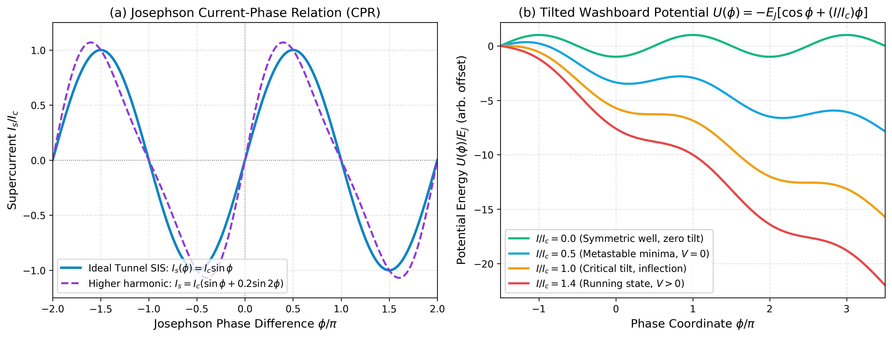
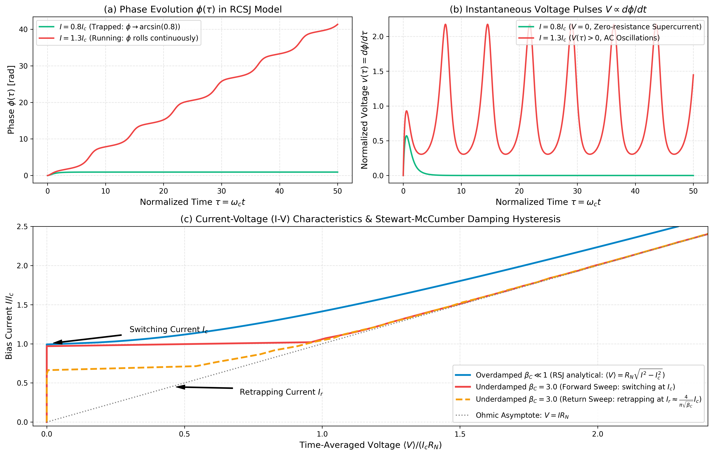
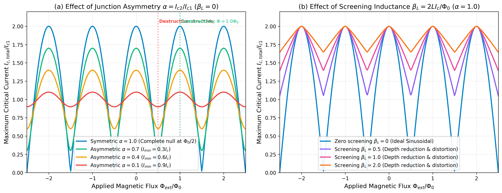
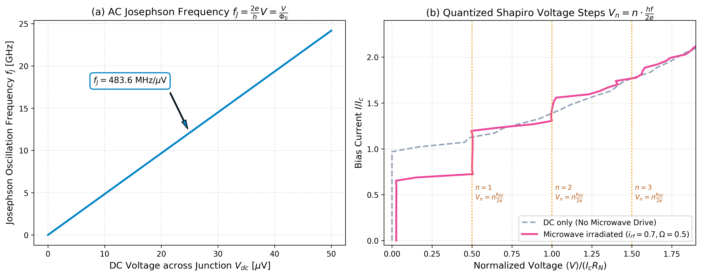
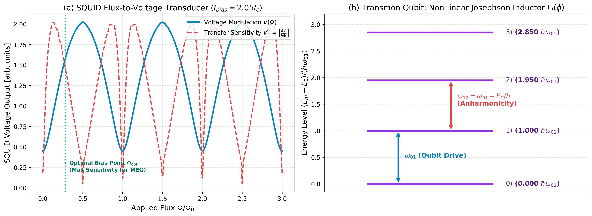

# Josephson Junctions & Superconducting Quantum Interference (DC SQUID)

> **Course:** Fundamentals of Quantum Transport and Nanoelectronics  
> **Topic:** Problem 8 — Josephson Junctions and Superconducting Quantum Interference  
> **Interactive Demo:** [interactive_demo/index.html](interactive_demo/index.html)  
> **Full Project Report:** [PROJECT_REPORT.md](PROJECT_REPORT.md) & [PROJECT_REPORT.pdf](PROJECT_REPORT.pdf)

---

## 🔬 Project Overview

This repository contains a complete theoretical model, numerical simulation suite, and interactive real-time visual demonstration of **Josephson junctions** and **DC Superconducting Quantum Interference Devices (SQUIDs)**. 

We model the macroscopic quantum wave mechanics of Cooper pairs ($\Psi = \sqrt{n_s} e^{i\theta}$), investigate the Resistively and Capacitively Shunted Junction (RCSJ) model, and simulate quantum phase interference modulated by magnetic flux $\Phi / \Phi_0$.

---

## 🌟 Key Features

1. **Interactive Web Simulator (`interactive_demo/index.html`)**:
   - **DC SQUID Matter-Wave Interference:** Live animation of bound Cooper pairs ($-2e$) streaming through a superconducting loop, magnetic field flux threading the ring, constructive/destructive interference, and real-time phasor vector addition.
   - **Tilted Washboard Physics Engine:** Real-time numerical integration of the washboard potential $U(\phi) = -E_J[\cos\phi + (I/I_c)\phi]$, showing the zero-voltage trapped state ($V=0$, supercurrent) and running state ($V>0$, AC Josephson oscillations).
   - **RCSJ I-V Curve Tracer:** Stewart-McCumber damping hysteresis ($\beta_C$) and microwave-induced phase-locking (**Shapiro Steps**).
2. **Python Numerical Simulation Suite (`simulation_suite.py`)**:
   - High-precision Runge-Kutta 4th/5th order ODE integration (`scipy.integrate.solve_ivp`).
   - Brent's method root-finding for finite-inductance screening loops ($\beta_L > 0$).
   - Generates 5 publication-quality 300-DPI figures saved in `figures/`.
3. **Academic Project Report (`PROJECT_REPORT.md` / `PROJECT_REPORT.pdf`)**:
   - Rigorous derivations from Feynman's coupled two-state quantum tunneling formalism.
   - Multi-parameter investigation across 5 physical variables.
   - In-depth physical discussion on Transmon qubits (non-linear Josephson inductance $L_J(\phi)$) and ultra-sensitive brain MEG magnetometry.

---

## 📊 Generated Publication Figures

| Figure | Description |
|:---:|:---|
|  | **Figure 1:** Josephson Current-Phase Relation (CPR) and Tilted Washboard Potential profiles at various current tilts $I/I_c$. |
|  | **Figure 2:** Time-domain phase evolution $\phi(\tau)$, instantaneous AC voltage pulses $V(\tau)$, and hysteretic I-V characteristics for underdamped junctions ($\beta_C = 3.0$). |
|  | **Figure 3:** SQUID quantum interference pattern $I_c(\Phi)$ vs applied flux $\Phi/\Phi_0$: effect of junction asymmetry $\alpha = I_{c2}/I_{c1}$ and screening inductance $\beta_L$. |
|  | **Figure 4:** Linear AC Josephson frequency relation ($f_J = 483.6\text{ MHz}/\mu\text{V}$) and quantized Shapiro voltage steps under microwave irradiation ($V_n = n \cdot hf/2e$). |
|  | **Figure 5:** SQUID flux-to-voltage transfer sensitivity for biomagnetism (MEG), and the Transmon qubit anharmonic energy spectrum ($|0\rangle, |1\rangle, |2\rangle$). |

---

## 🚀 Quick Start

### 1. Run the Interactive Web Simulator
Open `interactive_demo/index.html` in any browser:
```powershell
# Double-click or open directly:
Start-Process "interactive_demo/index.html"

# Or serve locally:
python -m http.server 8088 --directory "interactive_demo"
```
Visit `http://localhost:8088` in your browser.

### 2. Run the Scientific Simulation Suite
Install dependencies and run the simulation engine:
```powershell
pip install numpy scipy matplotlib reportlab
python simulation_suite.py
```
This recomputes the dynamical ODEs and updates all figures in `figures/`.

### 3. Re-compile the PDF Project Report
```powershell
python generate_pdf_report.py
```
Outputs the publication-ready PDF: `PROJECT_REPORT.pdf`.

---

## 📂 Repository Structure

```text
├── figures/
│   ├── fig1_josephson_energy_phase.png
│   ├── fig2_rcsj_dynamics_iv_curve.png
│   ├── fig3_squid_flux_interference.png
│   ├── fig4_shapiro_steps.png
│   └── fig5_quantum_phase_coherence_summary.png
├── interactive_demo/
│   └── index.html               # Real-time HTML5/Canvas interactive simulator
├── simulation_suite.py          # SciPy simulation & figure generator
├── generate_pdf_report.py       # ReportLab PDF compiler
├── PROJECT_REPORT.md            # Comprehensive academic report (Markdown)
├── PROJECT_REPORT.pdf           # Submission-ready formatted PDF report
├── README.md                    # Project documentation
└── .gitignore
```

---

## 📜 Governing Equations Summary

* **First Josephson Relation (DC):**
  $$I_s = I_c \sin(\phi)$$
* **Second Josephson Relation (AC):**
  $$\frac{d\phi}{dt} = \frac{2e}{\hbar} V = \frac{2\pi}{\Phi_0} V \quad \left(\Phi_0 = \frac{h}{2e} \approx 2.0678 \times 10^{-15}\text{ Wb}\right)$$
* **RCSJ Equation of Motion:**
  $$\beta_C \frac{d^2\phi}{d\tau^2} + \frac{d\phi}{d\tau} + \sin\phi = \frac{I}{I_c} + i_{rf}\sin(\Omega \tau)$$
* **SQUID Critical Current (Symmetric):**
  $$I_{c,\text{total}}(\Phi) = 2 I_c \left| \cos\left(\frac{\pi \Phi}{\Phi_0}\right) \right|$$
* **Shapiro Voltage Step Quantization:**
  $$V_n = n \frac{h f}{2e} = n \, \Phi_0 f$$

---

## 👥 Authors
Developed for **Fundamental of Quantum Transport and Nanoelectronics** (Course Project 2026).
